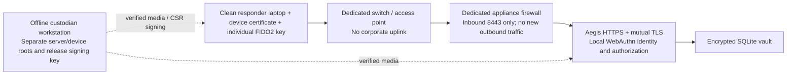

# Independent response enclave

This runbook implements deployment for tasks 1 and 2. It does not claim that the development laptop is clean or isolated. Use new or independently verified hardware and clean clients. Release 1.0 implements incident/scope, encrypted evidence quarantine/custody, approved reports and improvement actions. See ../DEMO.md for rehearsal and backup/restore commands, ../WORKFLOWS.md for incident operation and ../VALIDATION.md for actual verification and operational limits.

## Trust boundary



Corporate SSO, email, DNS, proxies, VPNs, hypervisors, storage and administrators are outside the boundary. Do not reuse their accounts or infrastructure. Infrastructure operators and the running enclave server remain privileged trust dependencies. Encryption does not hide plaintext from a compromised running server, and an enrolled certificate does not prove a client is clean. Use endpoint full-disk encryption and independent patching/management; do not import corporate browser profiles or synced credentials.

The application has no outbound connections, CDN, telemetry, mail, remote identity or metadata service. It accepts only WebAuthn `none` attestation to keep enrollment independent of metadata/revocation lookups. User verification is required and backup-eligible/synced credentials are rejected. Privacy-preserving attestation does not cryptographically certify the authenticator's manufacturer or hardware: issue and verify physical FIDO2 keys in person. The supplied device-key utility creates software-held keys; provision TPM-backed device certificates through your clean-device management process if required.

## Prepare and sign the offline release

On the independently managed build workstation, install Node 24 or newer, OpenSSL, tar and the locked dependencies. This preparation may use internet access; the deployed enclave does not.

```sh
npm ci
npm run check
npm test
npm run bundle -- --out /trusted-transfer/aegis-command-1.0.0.tar.gz
openssl dgst -sha256 -sign /offline-signing/release.key -out /trusted-transfer/aegis-command-1.0.0.tar.gz.sig /trusted-transfer/aegis-command-1.0.0.tar.gz
```

The bundle assembles production dependencies from the local npm cache with `--offline --omit=dev --ignore-scripts`. It includes a SHA-256 file manifest and excludes runtime databases, credentials, keys, tests and development dependencies. Keep the signing private key off the appliance. Provision its public verification key on the target through a separate trusted channel; a public key delivered only alongside the bundle is insufficient.

If the custodians do not already have a release-signing key, create one on their offline workstation before the signing step, and provision only its public key to verifiers:

```sh
openssl genpkey -algorithm RSA -pkeyopt rsa_keygen_bits:3072 -aes-256-cbc -out /offline-signing/release.key
openssl pkey -in /offline-signing/release.key -pubout -out /trusted-root/release.pub
```

On the offline target, verify the signature **before extracting or executing anything**:

```sh
openssl dgst -sha256 -verify /trusted-root/release.pub -signature aegis-command-1.0.0.tar.gz.sig aegis-command-1.0.0.tar.gz
tar -xzf aegis-command-1.0.0.tar.gz
cd aegis-command
node scripts/verify-manifest.mjs .
```

Provision the OS, Node runtime and nftables from separately verified offline media. No package manager or registry is needed during service startup. This release retains the prototype's Node architecture and uses an encrypted transactional SQLite vault instead of the proposed Go/PostgreSQL stack; it is a single-appliance implementation, not a high-availability cluster.

## Establish independent certificate roots

Use a clean OFFLINE custodian workstation. Create **separate** encrypted roots for server trust and device admission. The commands prompt for root-key passphrases; do not put them in shell arguments or copy root private keys to the appliance.

```sh
node scripts/pki.mjs init-ca /offline/server-ca "Aegis Server Root"
node scripts/pki.mjs init-ca /offline/device-ca "Aegis Device Root"
```

Generate the server private key and CSR on the prepared appliance. Transfer only the CSR to the root workstation:

```sh
node scripts/pki.mjs server-request /secure/server command.aegis.test
```

On the root workstation, sign the CSR and return the certificate and PUBLIC server root certificate:

```sh
node scripts/pki.mjs sign-server /offline/server-ca /transfer/server.csr /transfer/server.crt command.aegis.test
```

For each clean responder laptop, generate a distinct key and CSR **on that laptop**:

```sh
node scripts/pki.mjs device-request /secure/device responder-01
```

Transfer the CSR to the device root workstation, sign it, and return the certificate as the laptop's `/secure/device/identity.crt`. Do not transfer the laptop private key to the root workstation.

```sh
node scripts/pki.mjs sign-device /offline/device-ca /transfer/responder-01.csr /transfer/responder-01.crt
```

On the laptop, create a password-protected browser import package and record its fingerprint:

```sh
node scripts/pki.mjs export-device /secure/device /trusted-public/device-ca.crt
node scripts/pki.mjs fingerprint /secure/device
```

Import the PKCS#12 device identity into the clean browser/OS certificate store. Import the PUBLIC server root into its trusted root store after comparing its fingerprint through a separate trusted channel. Never bypass a certificate warning. Remove unnecessary copies of portable key packages after controlled import; keep any recovery copies independently encrypted. Rotate these 90-day leaf certificates before expiry; revoking a device in People prevents further application requests immediately, including over an existing TLS connection. A replacement certificate needs a new invitation or two-custodian recovery enrollment.

## Configure the dedicated Linux appliance

Use a separate physical switch/AP with **no corporate or internet uplink**. Give the server one enclave NIC, for example `enclave0` at `10.77.0.2/24`, and assign clean clients static addresses in the same subnet with no default gateway. Disable unused NICs, wireless, Bluetooth networking, corporate VPN/proxy agents and IP forwarding. For the server and clients, use a locally provisioned hosts entry:

```text
10.77.0.2 command.aegis.test
```

Use the local hardware clock or a separately trusted local time service. Corporate DNS, DHCP and NTP are not dependencies. Keep clocks accurate for certificate expiry and incident timestamps.

At the dedicated appliance's physical console, from the verified extracted release directory:

```sh
sudo sh deploy/install-appliance.sh --dedicated-appliance
```

The installer creates an unprivileged service user and installs source, environment and service templates. It does **not** start services or modify the running firewall. Review `/etc/aegis/aegis.env`, `/etc/aegis/enclave.nft` and the systemd `IPAddressAllow` setting together if changing the interface/subnet. The supplied firewall is a COMPLETE appliance ruleset with default-deny input, forwarding and output; it flushes prior rules when explicitly activated. Use only on the dedicated host, through its console. No SSH port is enabled.

Install the server key/certificate and public device CA:

```sh
sudo install -m 0600 -o aegis -g aegis /secure/server/identity.key /etc/aegis/secrets/server.key
sudo install -m 0640 -o root -g aegis /transfer/server.crt /etc/aegis/server.crt
sudo install -m 0640 -o root -g aegis /trusted-public/device-ca.crt /etc/aegis/device-ca.crt
sudo node /opt/aegis/scripts/operator.mjs keygen --out /etc/aegis/secrets/storage.key
sudo chown aegis:aegis /etc/aegis/secrets/storage.key
```

Keep the storage key separate from the database directory and maintain a separately controlled, encrypted recovery copy. The key is never generated implicitly or stored in source. The entire persisted vault, including identity, sessions, audit and incident data, is AES-256-GCM authenticated ciphertext. SQLite uses durable transactions; no plaintext incident payload enters its journal. Loss of the key makes the vault unreadable. Consistent manual encrypted vault/evidence backups and fresh restores are implemented through the operator CLI; the storage key is not included. Restore revokes sessions and pending enrollment/access approvals. Review and reapply any revocations issued after the recovery point before exposing the service. Automatic replication/recovery-node orchestration and independently anchored audit collection remain separate deployment work.

## Bootstrap two custodians

Two named custodians independently verify each other's identity, physical hardware keys and clean devices. Record each device's SHA-256 certificate fingerprint. With the service stopped, run:

```sh
sudo -u aegis /usr/bin/node --env-file=/etc/aegis/aegis.env /opt/aegis/scripts/operator.mjs bootstrap --first custodian1 --first-name "First Custodian" --first-device FIRST_SHA256_FINGERPRINT --second custodian2 --second-name "Second Custodian" --second-device SECOND_SHA256_FINGERPRINT
```

The command prints two 30-minute single-use invitation codes. Deliver each directly to its verified owner. No password, corporate email or universal bootstrap account exists. Bootstrap refuses to run again. Before both users enroll, an expired unused bootstrap invitation can be renewed from the physical console with `operator.mjs renew-bootstrap --username custodian2`; this path is disabled after two accounts have enrolled.

Activate the reviewed firewall and application:

```sh
sudo systemctl enable --now aegis.service
```

The service requires `aegis-firewall.service`, which validates and loads the default-deny rules before application startup. The application also runs unprivileged with a read-only system, restricted address families, process limits and an independent IP allowlist. It starts only with valid key/TLS configuration. It does not trust forwarded authentication or certificate headers; TLS terminates in the application itself. Do not put it behind a corporate proxy.

Each custodian visits the EXACT trusted origin, selects the matching device certificate, opens **Accept an administrator invitation**, and enrolls a physical security key with PIN/biometric verification. Register a separately stored spare key under **My access**. Administrators initially have **no incident-content access**. Explicitly assign commander/responder/observer membership in **People**, then sign in again after assignment; permission changes invalidate existing sessions.

Before an operational exercise, enroll a THIRD independently verified custodian and have the first two approve their administrator grant. Keep spare keys for each custodian. Recovery of an administrator who loses every key requires two OTHER active custodians; a two-person deployment cannot perform that ceremony when either person has lost all credentials. There is deliberately no universal bypass account.

## Routine access management

- Add a person in **People → Add an individual** after independent identity and clean-device verification. Default incident access is none. The invitation is shown once, bound to the certificate fingerprint, expires in 30 minutes, and cannot be reused.
- Suspend a person or revoke a device in **People**. The server checks current status for every request; the browser checks access at most every four seconds and removes displayed workspace content on revocation. Already viewed/exported information cannot be retracted.
- New administrator grants and account recovery require a proposal and approval by a DIFFERENT active custodian, each recently verified with a key. Requests expire after 15 minutes. Recovery revokes prior keys, sessions and devices and issues a 15-minute invitation for a newly prepared device. There is no email/SMS recovery path.
- Sessions use opaque Secure/HttpOnly/SameSite cookies, device binding, CSRF tokens and exact host/origin checks. Idle timeout is 15 minutes; polling without user interaction does not keep a session alive. Absolute timeout is 12 hours. Sensitive access changes require key verification within five minutes.
- The security audit contains attributed access changes and authentication results with a hash chain. Export an audit head using `operator.mjs audit-checkpoint` to compare against independently retained records. A local hash chain alone does not protect against a privileged operator who has the storage key or against rollback to an older encrypted vault.

## Demonstrate isolation and access control to judges

1. Physically disconnect corporate/internet links and disable their DNS, email, SSO and proxy paths. Keep ONLY the separate responder network connected.
2. Reboot the appliance and two clean clients. Check the firewall unit and app unit, and run `sudo nft list ruleset`. Record the appliance build digest, active interface addresses and root-certificate fingerprints.
3. On an approved clean device, configure `AEGIS_ORIGIN`, `AEGIS_SERVER_CA`, `AEGIS_PROBE_CERT` and `AEGIS_PROBE_KEY`, then run `node scripts/probe.mjs`. It checks trusted server TLS, rejection without a client certificate, device admission, and rejection of incident reads without a signed-in person.
4. Sign in with a physical key; invite a responder, explicitly assign the existing incident, send a message from a second device and observe the update. Create a new incident, select it in People when assigning access, and demonstrate incident-specific documentation and scope. The original sample remains a separate synthetic exercise.
5. Demonstrate that an observer cannot write; a platform administrator without incident membership cannot read the incident; forged `actor` input is rejected; a suspended user and revoked device lose access.
6. Capture packets on the enclave appliance while enrolling, authenticating and using existing workflows. Confirm only authorized incoming HTTPS and its responses. From the appliance, attempt connections to controlled external/corporate test addresses; the default-deny output policy must block NEW connections. The systemd IP policy provides an additional boundary. Perform this only in the isolated test setup.
7. Record actual results, packet captures and deviations. The automated localhost TLS tests do not prove physical network isolation, clean clients, Linux firewall enforcement or a penetration-test result.

## Updates and limitations

Stop the application at the physical console before replacing a release. Retain an independently encrypted copy of the vault and its separately controlled key under your custodians' procedure, verify the replacement release signature, test it against a restored copy, then replace the read-only application files and restart. Never delete a vault to recover an account. The initial prototype JSON state is not automatically imported, preventing an unaudited or unverified file from becoming trusted operational state.

This scope supplies access controls, encrypted local persistence, offline PKI/release tooling and a concrete isolated deployment profile. Release 1.0 also supplies the incident lifecycle, scope entry, evidence provenance/encrypted originals, approved post-incident reports, lessons/actions and tested manual backup/restore. Originals are quarantined, never previewed or unpacked, and require an external forensic review before controlled download; automatic malware scanning is not installed. A recovery node, scheduled replication, recipient-key export encryption, automatic redaction and an independently administered audit collector remain separate deployment work. Availability under network jamming, physical host loss, and compromise of the trusted enclave itself requires additional operational controls.

Implementation references: [SimpleWebAuthn server](https://simplewebauthn.dev/docs/packages/server), [Node TLS](https://nodejs.org/api/tls.html), [OWASP authorization](https://cheatsheetseries.owasp.org/cheatsheets/Authorization_Cheat_Sheet.html).
